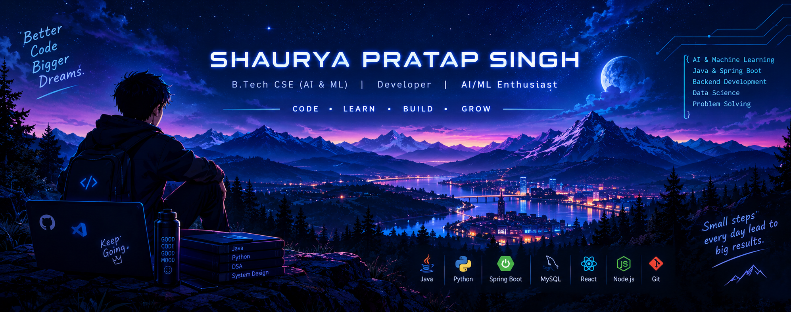

<div align="center">
  
</div>


<a href="https://github.com/theShaurya21">

</a>

<p>
  
  
  
</p>

<a href="https://github.com/theShaurya21">
  
</a>
<a href="https://www.linkedin.com/in/shaurya-pratap-singh-5a2153314/">
  
</a>

</div>

---

## `01` / ABOUT ME

```java
public class Shaurya {

    String degree = "B.Tech CSE (DATA SCIENCE)";
    String university = "GLA University";
    String[] interests = {
        "Artificial Intelligence",
        "Machine Learning",
        "Backend Development",
        "Data Structures & Algorithms"
    };

    String currentFocus = "Java & Spring Boot";

    String motto = "Learn. Build. Improve. Repeat.";
}
```

- Building practical software projects.
- Exploring AI, ML and data-driven solutions.
- Improving problem-solving and programming fundamentals.
- Interested in writing clean, maintainable code.

---

## `02` / TECH ARSENAL

<div align="center">

### Languages


### Frameworks & Database


### Tools & Environment


</div>

---

## `03` / FEATURED PROJECTS

<table>
<tr>
<td width="50%" valign="top">

### 🚌 SmartTransit

College transport safety and management platform.

- Bus and route management
- Live tracking interface
- Incident reporting

**Stack:** React · Node.js · Express · MongoDB

<a href="https://github.com/theShaurya21/SmartTransit">↗ Explore Repository</a>

</td>
<td width="50%" valign="top">

### 🤖 AI Resume Analyzer

An AI-focused resume analysis project.

- Resume information extraction
- Skills analysis
- Job-relevance insights

**Stack:** Add your actual implementation stack.

<a href="https://github.com/theShaurya21?tab=repositories">↗ Explore Projects</a>

</td>
</tr>
<tr>
<td width="50%" valign="top">


### ☕ Spring Boot Project

A dedicated Java backend project.

- REST API development
- MySQL integration
- CRUD operations

**Stack:** Java · Spring Boot · MySQL

<a href="https://github.com/theShaurya21?tab=repositories">↗ View Repositories</a>

</td>
</tr>
</table>

---

## `04` / GITHUB ANALYTICS

<div align="center">


<br/>


<br/>


</div>

---

## `05` / CURRENT MISSION

- [x] Build and submit SmartTransit.
- [ ] Develop a separate Spring Boot + MySQL project.
- [ ] Strengthen Java and DSA fundamentals.
- [ ] Build more AI/ML projects.
- [ ] Keep improving my GitHub portfolio.

---

<div align="center">

### Let's build something meaningful.

<a href="https://github.com/theShaurya21">GitHub</a> ·
<a href="https://www.linkedin.com/in/shaurya-pratap-singh-5a2153314/">LinkedIn</a>


</div>
